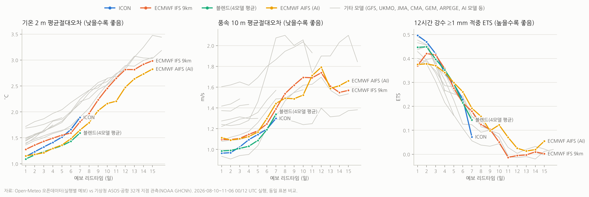

# 골프장 날씨 앱 개발 계획서 (가칭: **티업웨더 / TeeUp Weather**)

| 항목 | 내용 |
|---|---|
| 문서 버전 | v1.0 (초안) |
| 작성일 | 2026-11-10 |
| 1차 범위 | 대한민국 내 골프장 날씨 (웹 PWA → 모바일 앱) |
| 관련 자료 | [`research/model-verification/`](../research/model-verification/) — 날씨 모델 검증 코드·결과 |

---

## 목차

1. [개요](#1-개요)
2. [요구사항 정의](#2-요구사항-정의)
3. [날씨 모델 검증: 한국 날씨에 맞는 모델 찾기](#3-날씨-모델-검증-한국-날씨에-맞는-모델-찾기)
4. [데이터 소스](#4-데이터-소스)
5. [기능 상세 설계](#5-기능-상세-설계)
6. [시스템 아키텍처](#6-시스템-아키텍처)
7. [데이터 모델](#7-데이터-모델)
8. [API 설계](#8-api-설계)
9. [화면 설계](#9-화면-설계)
10. [개발 로드맵](#10-개발-로드맵)
11. [비용 추정](#11-비용-추정)
12. [라이선스·법률 체크리스트](#12-라이선스법률-체크리스트)
13. [리스크와 대응](#13-리스크와-대응)
14. [성공 지표 (KPI)](#14-성공-지표-kpi)
15. [바로 다음에 할 일](#15-바로-다음에-할-일)

---

## 1. 개요

### 1.1 배경

- 골퍼는 라운드 며칠 전부터 **강수·기온·바람**을 반복해서 확인한다. 우천 취소 여부, 옷차림, 클럽 선택(맞바람/뒷바람)이 날씨에 직접 좌우된다.
- 기존 서비스의 불편:
  - 기상청 날씨누리·포털 날씨는 **골프장 단위 검색이 안 되고** 행정동 단위로만 보여준다. 산간 골프장은 행정동 중심과 고도·지형이 크게 다르다.
  - Ventusky·Windy는 모델 선택과 지도 표현이 훌륭하지만 **골프장을 찾아 들어가기 번거롭고**, 모델별 신뢰도를 알려주지 않는다.
  - 여러 모델을 비교해 보는 습관이 있는 사용자(예: ICON 선호)도 **"어느 모델이 이 지역에서 실제로 잘 맞았는지"** 알 방법이 없다.
- 국내 골프장은 **546곳**(2026-01-01 기준, 운영 527·건설 중 11·미착공 8, 운영 중 회원제 152·비회원제 375; 한국골프장경영협회 집계, 세계일보 2026-06 보도)으로 데이터 규모가 작아 **전수 사전 계산(pre-compute)** 이 가능하다.

### 1.2 목표

1. 골프장을 고르면 **한 화면에서 7일(모델이 허용하면 최대 15~16일)** 강수·기온·바람을 확인한다.
2. **날씨 모델을 선택**할 수 있고, 각 모델의 **신뢰도(과거 실측 대비 성적)** 를 함께 보여준다.
3. **초성(예: `ㅂㅇㅋㄹㅋ` → 베어크리크)**·별칭·영문명으로 골프장을 검색한다.
4. **1시간 / 3시간** 단위 보기를 전환한다.
5. **Ventusky처럼 지도 위에서** 강수·기온·바람 레이어를 시간 슬라이더로 본다.
6. 1차는 **한국 골프장만** 대상으로 한다.

### 1.3 핵심 차별점

| 차별점 | 설명 |
|---|---|
| 골프장 단위 정밀 좌표 | 클럽하우스 좌표가 아니라 **코스 영역 중심 + 대표 고도**로 예보를 뽑고, 고도 차이는 기온 보정 |
| 모델 신뢰도의 투명한 공개 | 기상청 ASOS/AWS 실측과 매일 자동 대조해 **지역·리드타임·변수별 성적표** 제공 |
| 골프에 맞춘 요약 | 티업 시각 기준 **라운드 시간대(약 5시간)** 의 강수·바람·체감온도와 "라운드 적합도" 지수 |
| 모델 간 불확실성 | 여러 모델이 얼마나 다르게 예보하는지(스프레드)를 "오늘 예보의 확실성"으로 표시 |

---

## 2. 요구사항 정의

### 2.1 사용자 요구 → 기능 매핑

| # | 사용자 요구 | 기능 | 우선순위 |
|---|---|---|---|
| R1 | 골프장을 선택하면 한눈에 1주일 날씨, 가능하면 그 이후까지 | 골프장 상세: 요약 카드 + 일별 7일 + 확장 15일(모델별 한계 표시) | P0 |
| R2 | 날씨 모델 선택 + 모델 신뢰도 표시 | 모델 선택기, 모델별 신뢰도 배지(지역·리드타임별), 모델 비교 차트 | P0 |
| R3 | 골프장 위치 정확 파악, 초성 검색 | 골프장 마스터 DB(공공데이터 + 협회 + OSM + 검수), 초성·별칭·퍼지 검색 | P0 |
| R4 | 1시간 / 3시간 단위 보기 | 시간별 표·그래프 해상도 토글, 원자료 해상도 표시 | P0 |
| R5 | Ventusky처럼 지도에서 날씨, 상세한 지도 | MapLibre + VWorld(국토부) 배경지도 + 기상 레이어(강수·기온·바람 파티클) | P1 (기본 레이어 P0) |
| R6 | 한국 골프장 우선 | 데이터·검증·지도 영역을 한반도(33~39°N, 124~131°E)로 한정 | P0 |

### 2.2 비기능 요구사항

| 항목 | 목표 |
|---|---|
| 응답 속도 | 골프장 상세 첫 화면 LCP 1.5초 이내(모바일 4G), 검색 입력 반응 50ms 이내(클라이언트 검색) |
| 데이터 최신성 | 각 모델 새 실행(run) 공개 후 **30분 이내** 반영 |
| 가용성 | 99.5% (예보 JSON을 CDN 정적 파일로 제공하므로 API 서버 장애에도 조회 가능) |
| 정확성 투명성 | 신뢰도 점수의 산출 기간·표본 수·방법을 화면에서 확인 가능 |
| 접근성 | 색만으로 정보 전달 금지(강수 아이콘+수치 병기), 다크모드 |

---

## 3. 날씨 모델 검증: 한국 날씨에 맞는 모델 찾기

> 과거 예보를 실제 관측과 직접 대조해 "한국 날씨에 맞는 모델"을 찾았다. 코드와 전체 결과표는 [`research/model-verification/`](../research/model-verification/)에 있어 누구나 재현할 수 있다.

### 3.1 결론 요약

1. **ICON을 신뢰하는 것은 근거가 있다. 다만 1~3일 예보에서다.**
   - 1~3일 구간에서 ICON은 **단일 물리 모델 중 종합 1위**다.
     - 12시간 강수 유무(≥1 mm) 적중 ETS 0.46으로 13개 후보 중 1위.
     - 강수 빈도편향 1.12로 비 예보 남발이 가장 적다(ECMWF IFS 1.52, AIFS 1.86).
     - 풍속 오차 0.99 m/s로 물리 모델 중 1위.
     - 기온 오차 1.23 °C로 블렌드(1.16)·AIFS(1.18) 다음.
   - ECMWF IFS 9km와 같은 사례끼리 비교하면 ICON이 **기온 −0.13 °C, 풍속 −0.10 m/s, 강수 ETS +0.05**로 모두 앞선다(90% 신뢰구간이 0을 포함하지 않음).
2. **4~7일은 ECMWF 계열이 따라잡거나 앞선다.**
   - AI 모델 ECMWF AIFS가 기온(MAE 1.45 vs ICON 1.62 °C)과 강수(ETS 0.27 vs 0.23)에서 유의하게 우세하다.
   - ICON은 7일차 강수 적중이 급락하고(ETS 0.07), 예보 기간도 7.5일에서 끝난다.
3. **8~15일은 ECMWF AIFS > ECMWF IFS > 나머지.**
   - 강수는 10일 이후 사실상 맞히지 못한다(ETS ≈ 0).
   - 따라서 8일 이후는 "경향(참고)"으로만 표시한다.
4. **여러 모델의 평균(블렌드: IFS+ICON+UKMO+GFS)은 기온에서 1~7일 내내 최상위다.**
   - 하지만 강수량을 평균하면 약한 비가 과다 예보된다(빈도편향 1.53).
   - 그래서 앱의 강수 "유무"는 평균값이 아니라 **모델 다수결/확률**로 표시한다.
5. **기상청 계열 모델은 이번 검증에 넣지 못했다.**
   - KMA-UM은 2026년 종료됐다. Open-Meteo의 KMA 피드도 2026-04 이후 갱신이 멈췄다.
   - KIM은 공개 아카이브가 없다.
   - 출시 후 기상청 단기예보를 자체 수집해 같은 방식으로 검증한다(15장).

**리드타임별 앱 기본값(제안)**

| 리드타임 | 기온·바람 기본 | 강수 유무 판단 | 비고 |
|---|---|---|---|
| D+0~3 | **ICON**과 블렌드(ICON·AIFS·IFS·UKMO) | ICON·UKMO·IFS·MSM·ARPEGE **다수결** + 강수량 중앙값 | 사용자 선호 ICON을 기본으로 노출하고 블렌드 비교 |
| D+4~7 | **블렌드**(AIFS·IFS·ICON·UKMO) | AIFS·IFS·ICON 다수결 | ICON은 7일차부터 신뢰 급락 표시 |
| D+8~15 | **ECMWF AIFS**와 IFS(ECMWF 앙상블 확률 추가 검토) | 확률로만 표시 | "참고용" 회색 처리 |

### 3.2 검증 방법

| 항목 | 내용 |
|---|---|
| 예보 자료 | Open-Meteo 오픈데이터 AWS 버킷의 **실행별(run) 원본 예보** `s3://openmeteo/data_run/{model}/{yyyy}/{mm}/{dd}/{HHMM}Z/*.om` |
| 기간·실행 | 2026-08-10 ~ 11-06 초기화, **00 UTC·12 UTC 실행 178회**(모델당). 늦여름 장마 후반·태풍기·가을 포함 |
| 비교 모델 (12 + 블렌드) | DWD ICON, ECMWF IFS 9km, ECMWF IFS 0.25°, ECMWF AIFS, NCEP GFS 0.11°, NCEP AIGFS, UKMO 10km, JMA MSM 5km, JMA GSM, CMA GRAPES, Météo-France ARPEGE, CMC GEM 15km, **블렌드(IFS+ICON+UKMO+GFS 단순 평균, 사전 지정)** |
| 관측 | 기상청 ASOS 29개 지점(SYNOP/BUFR)과 공항 3곳(김포·서울공항·대구, METAR). NOAA GHCNh 2026 시간별 자료로 수집 |
| 지역 | 수도권·강원(대관령 844 m 포함)·충청·영남·호남·제주 |
| 격자 선택 | 관측소를 둘러싼 2×2 격자 중 **고도가 가장 비슷한 육지 격자**(바다 격자 제외) |
| 기온 보정 | 모델 지형고도 ↔ 관측소 고도 차이를 0.65 °C/100 m로 보정 |
| 기온·바람 | 00·06·12·18 UTC(09·15·21·03 KST) 값. 1·3·6시간 간격 모델을 공평하게 비교 |
| 강수 | 12시간·24시간 누적. BUFR 3시간 강수(02·05·…·23 UTC; 24시간 누적과 97~100% 일치)를 합산해 관측창이 모델창보다 1시간 앞섬(모든 모델 동일 조건) |
| 공정성 | 같은 리드타임에 **모든 모델이 예보를 가진 사례만** 비교(동일 표본). 그날을 끝까지 덮는 모델만 포함(예: ICON은 D1~7) |
| 지표 | MAE(평균절대오차), BIAS(평균 편차), 지속성 대비 스킬(1 − MAE/MAE<sub>지속성</sub>; 지속성 = 예보 시작 시점에 알 수 있던 같은 시각 관측값), 강수 ETS·POD·FAR·빈도편향(FBI) |
| 통계적 신뢰성 | 초기화 날짜 단위 블록 부트스트랩(500~1,000회) 90% 구간, 모델 쌍별 대응 비교 |
| 표본 수 | 리드타임별 기온 약 1.7~1.9만 쌍, 풍속 약 0.7~0.8만 쌍, 12시간 강수 ≥1 mm 관측 사례 약 650~830건 |

### 3.3 결과



#### (1) 1~3일 종합 성적 (모든 모델 공통 표본)

평균순위는 기온 MAE, 풍속 MAE, 12시간 강수 ETS, 24시간 10 mm 이상 ETS의 순위를 평균한 값이다.

| 순위 | 모델 | 기온 MAE (°C) | 기온 편차 | 풍속 MAE (m/s) | 풍속 편차 | 12h 강수≥1mm ETS | 빈도편향 | 24h 강수≥10mm ETS | 평균순위 |
|---|---|---|---|---|---|---|---|---|---|
| 1 | **블렌드(4모델)** | **1.16** | -0.40 | 1.00 | +0.54 | 0.431 | 1.53 | **0.489** | 2.5 |
| 2 | **DWD ICON** | 1.23 | -0.21 | 0.99 | +0.19 | **0.462** | **1.12** | 0.381 | 4.0 |
| 3 | UKMO 10km | 1.44 | -0.27 | 1.26 | +0.75 | 0.443 | 1.29 | 0.471 | 4.8 |
| 4 | ECMWF IFS 9km | 1.36 | -0.46 | 1.10 | +0.51 | 0.402 | 1.52 | 0.442 | 5.2 |
| 5 | ECMWF AIFS (AI) | 1.18 | +0.22 | 1.10 | +0.46 | 0.374 | 1.86 | 0.480 | 5.5 |
| 6 | ECMWF IFS 0.25° | 1.47 | -0.56 | 1.09 | +0.44 | 0.388 | 1.57 | 0.432 | 6.0 |
| 7 | NCEP AIGFS (AI) | 1.54 | -0.84 | **0.93** | -0.08 | 0.378 | 1.38 | 0.389 | 7.0 |
| 8 | CMC GEM | 1.51 | -0.69 | 1.12 | +0.51 | 0.421 | 1.37 | 0.403 | 7.0 |
| 9 | JMA MSM 5km | 1.57 | -0.41 | 1.45 | +0.99 | 0.435 | 1.15 | 0.430 | 8.2 |
| 10 | MF ARPEGE | 1.54 | +0.33 | 1.39 | +0.55 | 0.437 | 1.29 | 0.376 | 8.8 |
| 11 | NCEP GFS | 1.56 | -0.65 | 1.24 | +0.71 | 0.387 | 1.37 | 0.369 | 10.2 |
| 12 | JMA GSM | 1.80 | +0.28 | 1.63 | +0.81 | 0.422 | 1.31 | 0.379 | 10.8 |
| 13 | CMA GRAPES | 1.72 | -0.86 | 1.29 | +0.85 | 0.358 | 1.37 | 0.384 | 11.0 |

ETS 해석: 0 = 우연 수준, 1 = 완벽. 빈도편향(FBI): 1 = 비 예보 횟수가 실제와 같음, 1보다 크면 비를 너무 자주 예보.

#### (2) 리드타임 구간별 핵심 지표

각 리드타임에서 그날을 끝까지 덮는 모델끼리 동일 표본으로 비교했다. "—"는 예보 기간이 그 구간에 미치지 않는 경우다.

| 모델 | 기온 MAE D1-3 | D4-5 | D6-7 | D8-10 | D11-15 | 12h 강수 ETS D1-3 | D4-5 | D6-7 | D8-10 | D11-15 |
|---|---|---|---|---|---|---|---|---|---|---|
| **블렌드(4모델)** | **1.16** | **1.32** | **1.51** | — | — | 0.431 | **0.324** | 0.179 | — | — |
| **DWD ICON** | 1.23 | 1.46 | 1.78 | — | — | **0.462** | 0.317 | 0.151 | — | — |
| ECMWF AIFS (AI) | 1.18 | 1.33 | 1.57 | **1.99** | **2.57** | 0.374 | 0.320 | **0.226** | **0.126** | **0.037** |
| ECMWF IFS 9km | 1.36 | 1.52 | 1.70 | 2.22 | 2.84 | 0.402 | 0.317 | 0.197 | 0.093 | -0.002 |
| ECMWF IFS 0.25° | 1.47 | 1.62 | 1.79 | 2.31 | 2.91 | 0.388 | 0.301 | 0.198 | 0.090 | -0.003 |
| UKMO 10km | 1.44 | 1.61 | 1.82 | — | — | 0.443 | 0.311 | 0.174 | — | — |
| NCEP GFS | 1.56 | 1.77 | 2.09 | 2.40 | 2.93 | 0.387 | 0.210 | 0.082 | 0.039 | -0.008 |
| NCEP AIGFS (AI) | 1.54 | 1.75 | 2.08 | 2.49 | 3.07 | 0.378 | 0.284 | 0.195 | 0.103 | 0.021 |
| CMC GEM | 1.51 | 1.84 | 2.13 | 2.54 | — | 0.421 | 0.259 | 0.200 | 0.103 | — |
| JMA GSM | 1.80 | 2.01 | 2.24 | 2.51 | — | 0.422 | 0.268 | 0.124 | 0.087 | — |
| JMA MSM 5km | 1.57 | — | — | — | — | 0.435 | — | — | — | — |
| MF ARPEGE | 1.54 | — | — | — | — | 0.437 | — | — | — | — |
| CMA GRAPES | 1.72 | 1.86 | — | — | — | 0.358 | 0.189 | — | — | — |

| 모델 | 풍속 MAE D1-3 | D4-5 | D6-7 | D8-10 | D11-15 |
|---|---|---|---|---|---|
| **블렌드(4모델)** | 1.00 | 1.06 | 1.27 | — | — |
| **DWD ICON** | 0.99 | 1.12 | 1.25 | — | — |
| NCEP AIGFS (AI) | **0.93** | **0.99** | **1.25** | **1.27** | **1.33** |
| ECMWF IFS 0.25° | 1.09 | 1.14 | 1.25 | 1.55 | 1.59 |
| ECMWF IFS 9km | 1.10 | 1.16 | 1.32 | 1.62 | 1.63 |
| ECMWF AIFS (AI) | 1.10 | 1.15 | 1.37 | 1.50 | 1.67 |
| CMC GEM | 1.12 | 1.22 | 1.43 | 1.54 | — |
| NCEP GFS | 1.24 | 1.37 | 1.91 | 2.05 | 1.93 |
| UKMO 10km | 1.26 | 1.33 | 1.52 | — | — |

#### (3) ICON과 다른 모델의 대응 비교 (같은 사례, 90% 부트스트랩 구간)

| 구간 | 비교 | 기온 MAE 차 (°C) | 풍속 MAE 차 (m/s) | 12h 강수 ETS 차 | 해석 |
|---|---|---|---|---|---|
| D1-3 | ICON − ECMWF IFS 9km | **−0.13** (−0.15~−0.11) | **−0.10** (−0.12~−0.08) | **+0.050** (+0.027~+0.071) | ICON이 세 변수 모두 우세 |
| D1-3 | ICON − UKMO 10km | **−0.20** | **−0.26** | +0.007 (−0.016~+0.027) | 강수는 동률, 기온·바람은 ICON |
| D1-3 | ICON − ECMWF AIFS | +0.04 (AIFS 우세) | **−0.11** | **+0.074** | 기온만 AIFS, 바람·강수는 ICON |
| D1-3 | ICON − GFS | **−0.33** | **−0.24** | **+0.055** | ICON 압도 |
| D4-7 | ICON − ECMWF IFS 9km | +0.01 (−0.03~+0.05) | **−0.06** | −0.027 (−0.060~+0.004) | 기온 동률, 바람 ICON, 강수 IFS 소폭 우세(유의하지 않음) |
| D4-7 | ICON − ECMWF AIFS | **+0.19** (AIFS 우세) | **−0.09** | **−0.050** (AIFS 우세) | 4~7일은 AIFS가 기온·강수 우세 |

#### (4) 지역별 상위 모델 (1~3일, 모든 모델 공통 표본)

| 지역 (지점 수) | 기온 MAE 상위 3 | 풍속 MAE 상위 3 | 12h 강수 ETS 상위 3 |
|---|---|---|---|
| 수도권 (4) | AIFS 1.05 · 블렌드 1.17 · ICON 1.28 | 블렌드 · AIGFS · IFS9 | GEM 0.33 · IFS 0.25° 0.33 · IFS 9km 0.32 (ICON 0.27, 강수 사례 114건으로 적음) |
| 강원 (4) | AIFS 1.33 · 블렌드 1.35 · ICON 1.35 | AIGFS · 블렌드 · GFS | ARPEGE 0.41 · **ICON 0.38** · UKMO 0.37 |
| 충청 (6) | 블렌드 1.24 · AIFS 1.27 · ICON 1.28 | **ICON** · AIGFS · 블렌드 | MSM 0.48 · UKMO 0.47 · GEM 0.44 (ICON 0.44) |
| 영남 (8) | 블렌드 1.06 · AIFS 1.10 · ICON 1.13 | AIGFS · IFS 0.25° · AIFS | **ICON 0.52** · 블렌드 0.47 · GEM 0.46 |
| 호남 (7) | 블렌드 1.10 · ARPEGE 1.18 · ICON 1.19 | **ICON** · 블렌드 · ARPEGE | **ICON 0.52** · GEM 0.51 · GSM 0.51 |
| 제주 (3) | AIFS 1.15 · 블렌드 1.21 · ICON 1.28 | **ICON** · AIGFS · IFS 0.25° | **ICON 0.42** · UKMO 0.40 · GSM 0.39 |

ICON은 **모든 지역에서 기온 상위 3위**에 들었다. 강수는 영남·호남·제주에서 1위, 강원 2위였다. 수도권은 강수 관측 지점(인천·수원)이 적어 판단을 보류한다.

#### (5) 그 밖의 발견

- **바람은 대부분의 모델이 관측보다 0.5~1.0 m/s 강하게 예보한다**(ICON +0.2, AIGFS −0.1 제외).
  - 관측소 주변 지형·건물 차폐 때문일 가능성이 크다.
  - 골프장은 구릉·개활지라 관측소와 노출 조건이 달라, 일괄 보정은 위험하다.
  - 인근 AWS와 사용자 피드백이 쌓이면 지점별로 보정한다.
- **풍속은 지속성(어제 같은 시각의 바람)과 비교해도 모델의 우위가 작다**(스킬 −0.5~+0.2).
  - 바람은 국지 지형 영향이 커서 수치모델의 한계가 뚜렷하다.
  - 앱에서는 "풍속 범위"와 "돌풍"을 함께 보여주는 편이 정직하다.
- **기온은 대부분의 모델이 낮게 예보한다**(IFS −0.46, GFS −0.65 °C). AIFS·ARPEGE·GSM은 높게 예보한다.
  - 편차가 일정하므로 **지역별 편차 보정**만으로 오차를 더 줄일 수 있다(3단계 과제).
- **JMA MSM(5 km)은 해상도가 높지만** 3일 이내 기온·바람 오차가 ICON보다 크다. 강수 유무(ETS 0.435, FBI 1.15)는 상위권이다.
  - 따라서 강수 다수결의 구성원으로 쓴다.

### 3.4 앱의 "모델 신뢰도" 산출 방식

검증 결과를 사용자에게 보여줄 점수(0~100)와 별점(1~5)으로 바꾼다. 출시 후에는 **기상청 API허브 ASOS/AWS 실측으로 매일 갱신**하며, 권역 × 모델 × 리드타임별 **최근 90일 롤링** 값을 쓴다.

```
강수점수 = clamp(100 × ETS(12h, ≥1mm) / 0.5)          # ETS 0 → 0점, 0.5 → 100점
기온점수 = clamp(100 × (3.0 − MAE_기온) / 2.0)        # 3.0°C → 0점, 1.0°C → 100점
바람점수 = clamp(100 × (2.0 − MAE_풍속) / 1.2)        # 2.0 m/s → 0점, 0.8 m/s → 100점
신뢰도   = 0.45 × 강수점수 + 0.35 × 기온점수 + 0.20 × 바람점수
별점     = ≥85 ★5 · ≥70 ★4 · ≥55 ★3 · ≥40 ★2 · 그 외 ★1
```

이번 검증 데이터(전국)에 적용한 예:

| 모델 | D+1 | D+2 | D+3 | D+4 | D+5 | D+6 | D+7 | D+8 | D+10 | D+12 | D+15 |
|---|---|---|---|---|---|---|---|---|---|---|---|
| DWD ICON | **95** | **90** | **83** | 73 | 67 | 58 | 38 | — | — | — | — |
| 블렌드(4모델) | 90 | 89 | 83 | **78** | **71** | 60 | 48 | — | — | — | — |
| UKMO 10km | 86 | 82 | 71 | 66 | 61 | 50 | 39 | — | — | — | — |
| CMC GEM | 83 | 82 | 71 | 58 | 55 | 50 | 36 | 32 | 20 | — | — |
| ECMWF AIFS (AI) | 81 | 81 | 80 | 75 | 69 | **62** | **50** | **44** | **34** | **15** | **14** |
| NCEP AIGFS (AI) | 81 | 78 | 73 | 66 | 62 | 51 | 41 | 34 | 28 | 13 | 12 |
| ECMWF IFS 9km | 79 | 82 | 80 | 73 | 64 | 56 | 47 | 37 | 19 | 8 | 8 |
| JMA MSM 5km | 79 | 76 | 66 | — | — | — | — | — | — | — | — |
| NCEP GFS | 78 | 73 | 67 | 57 | 44 | 32 | 19 | 16 | 12 | 4 | 1 |
| JMA GSM | 68 | 68 | 60 | 52 | 42 | 29 | 26 | 19 | 12 | — | — |

이와 별도로 **"오늘 예보의 확실성"** 을 보여준다. 이것은 과거 성적이 아니라 이번 예보에 대한 모델 간 일치도다.
- 계산: 같은 시각 모델들의 기온 표준편차와 강수 유무 일치율.
- 표시: 높음/보통/낮음 3단계.

### 3.5 한계와 후속 검증

| 한계 | 영향 | 후속 조치 |
|---|---|---|
| 기간이 3개월(2026-08~11)뿐 | 겨울 강설·봄철 황사기·장마 전반은 미반영. 계절에 따라 순위가 바뀔 수 있음 | 출시 후 자동 검증으로 **계절별** 성적 축적. Open-Meteo Previous Runs API(2024~)로 과거 1년 이상 추가 검증 |
| 기상청 모델(KIM)·기상청 예보 미포함 | "한국 모델" 비교 공백 | 기상청 단기예보를 매 발표 수집·보관해 같은 지표로 비교 |
| 관측소 위치 ≠ 골프장 | 골프장(구릉·산간) 대표성 제한 | 골프장 인근 AWS 매핑, 대관령 같은 고지대 결과는 따로 표시 |
| 강수 관측창 1시간 차이 | 모든 모델에 같은 조건이라 순위 영향은 작음 | 기상청 API허브 시간강수로 교체 |
| 블렌드는 단순 평균 | 성적 가중 시 추가 개선 여지 | 지역·리드타임별 가중치 학습(과적합 방지 위해 기간 분리 검증) |

---

## 4. 데이터 소스

### 4.1 기상 데이터

#### 4.1.1 모델 예보 (포인트 예보 + 지도 격자)

| 모델 | 기관 | 수평 해상도 | 예보 기간 (00/12Z 기준) | 시간 간격 | 실행 | 비고 |
|---|---|---|---|---|---|---|
| ECMWF IFS HRES | ECMWF | 9 km (O1280) | 15일 (06/18Z는 6일) | 1h → 90h 이후 3h → 144h 이후 6h | 4회/일 | 2025-10부터 9km 오픈데이터 |
| ECMWF IFS 0.25° | ECMWF | ~25 km | 15일 | 3h → 6h | 4회/일 | |
| ECMWF AIFS Single | ECMWF | 0.25° | 15일 | 6h | 4회/일 | AI 모델 (2025-02 운영) |
| **DWD ICON** (Global) | 독일 기상청 | 13 km (Open-Meteo 0.125° 재격자) | **7.5일 (180h)**, 06/18Z 5일 | 1h → 78h 이후 3h | 4회/일 | 사용자 선호 모델 |
| NCEP GFS | 미국 NOAA | 0.11° (~13 km) | 16일 | 1h → 120h 이후 3h | 4회/일 | |
| NCEP AIGFS | 미국 NOAA | 0.25° | ~16일 | 6h | 4회/일 | AI 모델 |
| UKMO Global | 영국 기상청 | 10 km | 7일 (06/18Z 2.5일) | 1h → 3h → 6h | 4회/일 | |
| JMA MSM | 일본 기상청 | 5 km (한반도 포함 영역) | 3.25일 (78h) | 1h | 8회/일 | 영역 모델 |
| JMA GSM | 일본 기상청 | 0.5° | 11일 | 6h | 4회/일 | |
| CMA GRAPES | 중국 기상청 | 0.125° | 5일 (아카이브 기준) | 3h | 4회/일 | |
| Météo-France ARPEGE | 프랑스 기상청 | 0.25° | 4.25일 | 1h → 3h | 4회/일 | |
| CMC GEM | 캐나다 기상청 | 15 km | 10일 | 1h → 3h | 2회/일 | |
| **기상청 단기예보** | KMA | 5 km 격자 (nx, ny) | 약 5일 (그글피; 5일차 일부 정성) | 1h | 8회/일 (02·05·…·23시 발표) | data.go.kr 공공API, 예보관 보정 결과 |
| **기상청 중기예보** | KMA | 시·도 권역 → **2026-11 디지털 중기예보 5 km 도입 예정** | 4~10일 | 일 단위 (디지털: 3h/6h) | 2회/일 | API 제공 범위 확인 필요 |
| KIM (한국형 수치모델) | KMA | 8 km 전구 | 12일 | | 2회/일 | 2026년 KMA-UM 종료 후 단독 운영. 원시자료 외부 제공 범위 확인 필요 |

> **중요 — KMA 모델 접근성 변화:** Open-Meteo가 제공하던 KMA GDPS/LDPS(UM 기반)는 **2026-03-31 이후 갱신 중단**(아카이브 메타데이터상 마지막 자료 2026-04-04)되었다. 기상청이 2026년 KMA-UM을 종료하고 KIM 단독 운영으로 전환한 시기와 일치한다. 따라서 "기상청" 선택지는 **기상청 단기/중기예보 API**로 제공하고, KIM 원시자료는 기상청 API허브/기상자료개방포털 제공 여부를 확인한 뒤 추가한다.

#### 4.1.2 제공 경로 비교

| 경로 | 장점 | 단점 | 권장 용도 |
|---|---|---|---|
| **Open-Meteo 상업 API** (Standard $29/월·100만 호출, Professional $99/월) | 12개 이상 모델을 한 API로, 고도 보정·변수 통일 | 외부 의존, 호출량 과금 | **MVP 포인트 예보** |
| **Open-Meteo 오픈데이터 (AWS `s3://openmeteo`)** 자체 처리 | 호출 과금 없음, 실행별(`data_run`)·지도용(`data_spatial`) 원본 파일, CC BY 4.0 | 처리 파이프라인 직접 운영 | **지도 타일 생성**, 검증, 장기적으로 포인트 예보 자체 호스팅 |
| 각 기관 원본 GRIB (ECMWF/DWD/NOAA 오픈데이터, AWS Open Data) | 가장 원천 | 변환 부담 큼 | 필요 시 |
| 기상청 공공데이터 (data.go.kr) | 공식 예보, 한국어 날씨 표현 | 일일 호출 한도(개발계정 1만 회/일, 운영계정 상향 신청), 격자 5 km | "기상청 예보" 선택지 |
| 기상청 API허브 (apihub.kma.go.kr) | ASOS/AWS 실측, 레이더·위성 | 키 발급 필요 | **실측(현재 날씨)·검증** |

#### 4.1.3 실측 자료 (검증·현재 날씨용)

- **기상청 ASOS(약 100곳) / AWS(약 500곳)** — API허브 지상관측. 골프장 반경 10~20 km 이내 AWS를 매핑해 "지금 골프장 근처 날씨"와 검증에 사용.
- 본 계획서의 사전 검증에서는 네트워크 제약으로 NOAA GHCNh(전 세계 시간별 관측, 기상청 ASOS 전문 포함)를 사용했다.

### 4.2 골프장 마스터 데이터

| 소스 | 내용 | 용도 | 주의 |
|---|---|---|---|
| 행정안전부 지방행정 인허가 데이터 — "골프장" 업종 (2026-01부터 공공데이터포털 API로 이관) | 사업장명, 영업상태, 주소, 인허가일, **좌표(X, Y)** | **기본 목록과 좌표** | 좌표계 **EPSG:5174** (Bessel 중부원점 TM, 보정계수 미적용). 일부 지자체 자료는 EPSG:2097 → 파일별로 확인 후 WGS84 변환 |
| 한국골프장경영협회(KGBA) 회원사 목록·연감 | 회원제/대중제, 홀 수, 휴장 정보 | 분류·보강 | 공개 범위 확인 |
| OpenStreetMap `leisure=golf_course` | **코스 영역 폴리곤**, 일부 홀 배치 | 코스 중심점·면적·지도 표시 | ODbL — 출처 표시, 파생 DB 공개 시 동일 조건 |
| 국토지리정보원 수치표고(DEM) / Copernicus DEM | 고도 | 코스 대표 고도 → 기온 고도 보정 | |
| 카카오·네이버·구글 장소 API | 장소 ID, 전화, 링크 | **검수 보조·딥링크만** | 카카오 로컬 결과의 DB화(캐시 보관) 금지, 구글은 좌표 30일 캐시 한도(place_id만 영구 저장 가능) → **좌표의 원천은 공공데이터** |
| 경기도 골프장 현황(경기데이터드림) | WGS84 좌표 | 경기권 교차 검증 | 경기도만 |

**골프장 DB 구축 절차**

1. 인허가 데이터에서 "영업/정상" 상태 골프장 추출 → EPSG:5174 → EPSG:4326 변환(`pyproj`).
2. KGBA 목록과 **명칭 정규화 후 매칭**(“CC/C.C/컨트리클럽/골프클럽/GC/골프앤리조트” 제거, 공백·특수문자 제거).
3. OSM 골프장 폴리곤과 공간 조인(클럽하우스 점이 폴리곤 내부 또는 1 km 이내) → **코스 중심점(centroid)**, 면적, 대표 고도(폴리곤 내부 DEM 중앙값) 계산.
4. 위성지도(VWorld) 위에 띄워 **수작업 검수**(546곳, 1인 2~3일). 신규·폐업은 인허가 데이터 주기 동기화(월 1회) + 사용자 제보.
5. 별칭 사전 구축: 공식명, 약칭, 구 명칭, 영문명(예: `Bear Creek`), 흔한 오타.

### 4.3 지도 데이터

| 후보 | 상세도(한국) | 비용 | 기상 오버레이 적합성 | 평가 |
|---|---|---|---|---|
| **VWorld (국토교통부 브이월드)** | 매우 높음 — 일반·**위성·하이브리드** WMTS (EPSG:3857) | 무료(키 발급, 출처 표시) | **MapLibre에 바로 래스터 소스로 사용** 가능 | ✅ **기본 배경지도로 채택** |
| 구글 지도 | 국내 상세도는 제한적. 2026-02 정부가 1:5,000 지도 국외 반출을 **조건부 승인**(보안시설 블러, 국내 파트너 처리 등), 2026-10 기준 반영 진행 중 | Maps JS 사용량 과금 | deck.gl `GoogleMapsOverlay`로 가능 | 해외 사용자/위성 보조로 **2차 옵션**. 반출 반영 후 재평가 |
| 네이버 지도 (NCP Maps) | 매우 높음 | 2025년 신규 Maps 상품 개편, 무료 한도는 대표 계정 기준 | 커스텀 WebGL 레이어 연동이 번거로움 | **길찾기 딥링크** |
| 카카오맵 | 매우 높음 | 2026-07부터 무료 한도는 계정당 첫 앱만 | 타일 좌표계 EPSG:5181 → MapLibre와 부적합 | **길찾기 딥링크** |
| OSM 기반 벡터 타일 (OpenFreeMap/MapTiler 등) | 중간 | 무료~저가 | 우수 | 라벨/도로 오버레이 보조 |

> **결론:** MapLibre GL JS + **VWorld 위성/하이브리드** 배경 + 자체 기상 타일(강수·기온·바람) + deck.gl 바람 파티클. "길찾기"는 네이버·카카오·티맵 앱 딥링크로 연결.

---

## 5. 기능 상세 설계

### 5.1 골프장 검색 (초성·별칭·퍼지)

**인덱스 구조 (골프장 1곳당)**

```json
{
  "id": "gc_0123",
  "name": "베어크리크 골프클럽",
  "name_norm": "베어크리크",
  "aliases": ["베어크리크", "베어크리크CC", "Bear Creek", "베어크릭"],
  "choseong": ["ㅂㅇㅋㄹㅋ", "ㅂㅇㅋㄹㅋㄱㅍㅋㄹ"],
  "region": "경기 포천시",
  "lat": 37.86, "lon": 127.24
}
```

**검색 알고리즘 (클라이언트, 약 550개 × 평균 5개 키 → 100 KB 미만, 입력마다 1 ms 미만)**

1. 질의 정규화: 소문자화, 공백·`CC/GC/골프장/컨트리클럽` 등 접미어 제거.
2. 질의 문자 유형 판별 — 모든 문자가 자음(ㄱ-ㅎ)이면 **초성 모드**, 섞여 있으면 **혼합 모드**.
3. 혼합 모드는 **문자 단위 매칭**: 질의 문자가 자음이면 대상 음절의 초성과, 완성형이면 음절과 비교하고, 마지막 글자는 입력 중일 수 있으므로 자모 분해 접두 비교(`베어크ㄹ`, `베어크릭` 대응). 구현은 `es-hangul`(토스, MIT)의 `getChoseong`, `disassemble` 사용(v2에서 `chosungIncludes`가 제거되어 직접 구현).
4. 점수: 정확 일치 100 > 이름 접두 90 > 초성 접두 80 > 별칭 일치 75 > 부분 문자열 60 > 퍼지(자모 단위 편집거리 ≤ 2) 40. 동점은 즐겨찾기 → 최근 조회 → 사용자와의 거리 순.
5. 결과 0건이면 서버 폴백(PostgreSQL `pg_bigm` 또는 `pg_trgm` + 초성 컬럼)으로 퍼지 검색하고 미등록 골프장 제보 버튼을 보여준다.

**예시**

| 입력 | 결과 |
|---|---|
| `ㅂㅇㅋㄹㅋ` | 베어크리크 골프클럽(포천·춘천) |
| `ㄴㅅㅇ` | 남서울CC |
| `스카이` / `ㅅㅋㅇ72` | 스카이72 (영문·숫자 혼합 처리) |
| `잭니클` | 잭니클라우스 GC 코리아 |
| `jack` | 잭니클라우스 (영문 별칭) |

### 5.2 골프장 상세 — "한눈에 보기"

```
┌───────────────────────────────────────────┐
│ ⛳ 베어크리크 GC (포천)   ★즐겨찾기   [길찾기] │
│ 모델: [ICON ▾]   신뢰도 ●●●●○ (D+3, 수도권)   │
├───────────────────────────────────────────┤
│ 오늘  11/14(토) 티업 07:00 기준 라운드 예보      │
│ 🌧 강수 0.4mm (07–12시)  💨 4→7m/s 북서        │
│ 🌡 6→12°C 체감 3°C   라운드 적합도 72/100     │
│ 모델 간 일치도: 높음 (강수 5개 모델 중 4개 무강수) │
├───────────────────────────────────────────┤
│ 일별 7일 (스크롤 → 15일, 8일 이후 회색 '참고')  │
│ 토 ☀ 12/3°  0mm  5m/s │ 일 🌧 9/4° 6mm 8m/s … │
├───────────────────────────────────────────┤
│ 시간별  [1시간|3시간]  그래프: 기온·강수막대·바람화살표 │
├───────────────────────────────────────────┤
│ 모델 비교 (같은 축에 여러 모델 강수/기온 선)     │
└───────────────────────────────────────────┘
```

- **요약 카드**: 사용자가 지정한 티업 시각(기본 07:00)부터 5시간 구간의 강수 합계·최대 시간 강수·풍속(평균/돌풍)·기온 범위·체감온도.
- **라운드 적합도(0~100)**: 강수(가중 40)·바람(25)·체감온도(25)·낙뢰 위험(CAPE·대류성 강수, 10). 가중치는 사용자 피드백("실제 라운드 어땠나요?")으로 조정.
- **일별 7일 → 15일 확장**: 8일 이후는 신뢰도 낮음 스타일(회색·점선)과 "참고용" 라벨. 모델별 최대 예보 기간을 넘으면 해당 모델 칸을 비움.
- **모델 비교 뷰**: 선택한 2~5개 모델의 기온선·강수막대를 겹쳐 표시하고 **다중 모델 평균("블렌드")** 을 굵은 선으로 표시.

### 5.3 1시간 / 3시간 단위 보기

- **1시간 모드**: 원자료가 1시간인 구간은 그대로, 3·6시간 구간(예: ICON 78h 이후, IFS 90h 이후)은 **보간값을 흐리게** 표시하고 "이 구간은 3시간 자료" 툴팁을 단다. 강수는 3시간 합계를 1시간씩 나눠 보여주지 않고 **3시간 막대 하나로** 표시해 왜곡을 막는다.
- **3시간 모드**: 00·03·…·21시 슬롯. 강수는 3시간 합계, 바람은 구간 최대 돌풍과 평균, 기온은 해당 시각 값.
- 표기 단위: 기온 °C, 강수 mm, 풍속 m/s(설정에서 km/h·kt 선택), 풍향 16방위 + 화살표. **골프 친화 표시**: "맞바람/뒷바람"은 홀 방향 데이터가 없으므로 2차 과제(홀 방위 데이터를 OSM `golf=hole`에서 확보 가능하면 적용).

### 5.4 모델 선택과 신뢰도 표시

- 모델 선택기 항목: **추천(블렌드)**, ECMWF IFS, ICON, GFS, UKMO, JMA MSM(3일), 기상청 단기예보(5일), GEM, AIFS/AIGFS(AI), 기타.
- 각 항목 옆 **신뢰도 배지**: 해당 골프장 권역 × 리드타임 × 변수의 최근 90일 성적(3장의 방법)을 5단계로 표시. 탭하면 "ICON · D+3 · 전국: 기온 평균오차 1.32°C, 12시간 강수 적중 ETS 0.42, 풍속 평균오차 1.02 m/s (2026-08-10~11-06, 기온 17,480쌍)" 같은 근거를 보여준다(3장 검증의 실제 값).
- **"오늘 예보의 확실성"**: 다중 모델 스프레드(기온 표준편차, 강수 유무 일치율) 또는 ECMWF 앙상블 스프레드 → 높음/보통/낮음.

### 5.5 지도 화면 (Ventusky 스타일)

| 레이어 | 표현 | 원천 |
|---|---|---|
| 강수 (1h/3h 합계) | 컬러 래스터 + 레이더 실황(선택) | 모델 격자, 기상청 레이더(API허브) |
| 기온 2 m | 컬러 래스터 + 등온선 | 모델 격자 |
| 바람 10 m / 돌풍 | **WebGL 파티클 애니메이션** + 풍속 컬러 | u/v 격자 |
| 구름량, 기압 | 래스터 / 등압선 | 모델 격자 |
| 골프장 마커 | 줌별 클러스터, 마커에 당일 아이콘·기온 | 사전 계산 포인트 예보 |

- **시간 슬라이더**(1h/3h 간격, 재생 버튼), **모델 선택**, 범례, 지점 탭 시 미니 예보 팝업.
- 타일 생성: Open-Meteo `data_spatial`(유효시각별 전구 파일, 예: ICON 1개 시각 약 155 MB)에서 **한반도 주변 영역만 부분 읽기** → 값 인코딩 PNG/WebP 타일(z4~z10) → 객체 스토리지 + CDN. 바람은 u·v를 R·G 채널에 담은 텍스처 1장(시각당)으로 클라이언트 셰이더가 파티클 계산.
- 구현 후보: `deck.gl` + `weatherlayers-gl`(라이선스·유료 기능 확인), 또는 자체 WebGL 파티클(`webgl-wind` 방식, 오픈소스 예제 다수).

### 5.6 부가 기능 (2차)

- 즐겨찾기·예약 라운드 등록 → D-3/D-1/당일 아침 **예보 변화 푸시 알림**(예: "토요일 강수 예보가 0mm → 8mm로 바뀌었어요").
- 일출·일몰(첫 티업/야간 라운드), 미세먼지(에어코리아), 낙뢰(기상청 낙뢰 API), 체감온도·자외선.
- "실제 날씨 어땠나요?" 피드백 → 적합도 지수 개선, 로컬 보정 연구 자료.

---

## 6. 시스템 아키텍처

```
                ┌──────────── 수집·처리 (Python 워커, 스케줄러) ───────────┐
 Open-Meteo API ─┤ ① 포인트 예보 수집: 골프장 546곳 × 모델 N               │
 (상업 구독)      │    → 단위 통일·고도 보정·1h/3h 집계 → JSON              │
 기상청 단기/중기 ─┤ ② 기상청 예보 수집: 5 km 격자(nx,ny) 매핑             │
 (data.go.kr)    │                                                     │
 AWS openmeteo ──┤ ③ 지도 타일 생성: data_spatial 부분 읽기 → PNG 타일    │
 (data_spatial)  │                                                     │
 기상청 API허브 ──┤ ④ 실측 수집(ASOS/AWS 매시) → ⑤ 검증·신뢰도 산출(매일) │
                └─────────────┬───────────────────────┬──────────────┘
                              ▼                       ▼
                 객체 스토리지(S3/R2) + CDN      PostgreSQL + PostGIS
                 /fc/{course}/{model}.json      골프장·별칭·관측·검증 통계
                 /tiles/{model}/{run}/{var}/{t}/{z}/{x}/{y}.png
                              │                       │
                              ▼                       ▼
                  ┌──────── API 서버 (FastAPI) ────────┐
                  │ 검색 폴백, 신뢰도 조회, 즐겨찾기, 푸시 │
                  └──────────────┬────────────────────┘
                                 ▼
             웹 PWA (Next.js + MapLibre + deck.gl) → 모바일 앱(Expo/React Native)
```

### 6.1 기술 스택

| 영역 | 선택 | 이유 |
|---|---|---|
| 프론트 | **Next.js (TypeScript) PWA**, MapLibre GL JS, deck.gl, ECharts/visx | 웹 먼저 출시해 검증, 지도·차트 생태계 |
| 모바일 | Expo(React Native) 또는 Capacitor로 PWA 래핑 | 코드 재사용, 푸시 알림 |
| 백엔드 API | **FastAPI (Python)** | 수집·검증 코드와 언어 통일 |
| 수집·처리 | Python (`omfiles`, `xarray`, `pyproj`, `pandas`), 스케줄러: Cloud Run Jobs / AWS ECS Scheduled Task (초기엔 GitHub Actions cron도 가능) | 실행 감시(`latest.json`) 기반 이벤트 처리 |
| DB | PostgreSQL 16 + PostGIS (+ `pg_bigm`) | 공간 질의, 검색 폴백, 검증 통계 |
| 저장/배포 | S3 또는 Cloudflare R2 + CDN | 예보 JSON·타일을 정적 파일로 → 저비용·고가용 |
| 모니터링 | Sentry, Grafana(수집 지연·실패율), 검증 대시보드 | |

### 6.2 데이터 흐름과 갱신 주기

1. **모델 실행 감시**: 각 모델 메타(`/data/{model}/static/meta.json`의 `last_run_initialisation_time`)를 5~10분마다 확인 → 새 실행이면 해당 모델만 재계산.
2. **포인트 예보 생성**: 골프장 좌표·대표 고도로 Open-Meteo 다지점 요청(좌표 여러 개를 한 번에 요청) → 변수: 기온, 체감온도, 강수, 강수확률(앙상블), 풍속·풍향·돌풍, 구름량, CAPE, 날씨코드 → 1h/3h 두 해상도 JSON 저장(gzip 약 30~60 KB).
3. **블렌드 생성**: 같은 시각에 존재하는 모델들의 **검증 성적 가중 평균**(초기에는 3장 결과의 상위 모델 단순 평균) → `blend.json`.
4. **기상청 예보**: 골프장별 (nx, ny) 사전 매핑 → 발표 시각 + 10분에 수집.
5. **검증**: 매일 새벽 전날 실측과 지난 15일치 예보를 대조 → 권역 × 모델 × 리드타임 × 변수별 누적 통계(최근 30/90일) 갱신 → 신뢰도 배지 갱신.

### 6.3 규모 산정

- 호출량(Open-Meteo): 546곳 ÷ 다지점 요청 50곳 ≈ 11요청 × 모델 12 × 하루 4회 ≈ 530요청/일. 변수·기간 가중치(변수 10개 초과·2주 초과 시 가중)를 감안해도 **월 100만 호출 한도 이내**.
- 저장량: 예보 JSON 546 × 13(모델+블렌드) × 50 KB ≈ 355 MB/세대, 최근 3세대 보관. 지도 타일: 모델 3개 × 변수 4개 × 시각 72개 × 타일 약 300장 × 20 KB ≈ 5 GB/세대.

---

## 7. 데이터 모델

```sql
-- 골프장
CREATE TABLE golf_course (
  id            text PRIMARY KEY,            -- gc_0123
  name          text NOT NULL,               -- 공식명
  name_norm     text NOT NULL,               -- 접미어 제거 정규화명
  choseong      text NOT NULL,               -- 정규화명 초성
  type          text,                        -- 회원제 / 비회원제 / 군 / 기타
  holes         int,
  status        text NOT NULL,               -- 운영 / 휴장 / 건설 / 폐업
  address       text,
  sido          text, sigungu text,
  clubhouse     geography(Point, 4326),
  course_area   geography(MultiPolygon, 4326),
  centroid      geography(Point, 4326),      -- 예보 산출 지점
  elevation_m   real,                        -- 코스 대표 고도 (DEM 중앙값)
  kma_nx int, kma_ny int,                    -- 기상청 단기예보 격자
  region_code   text,                        -- 검증 권역 (수도권/강원/충청/영남/호남/제주)
  nearest_aws   text[],                      -- 인근 AWS/ASOS 지점
  source        jsonb,                       -- 인허가 관리번호, KGBA, OSM id, 외부 place id
  updated_at    timestamptz DEFAULT now()
);
CREATE TABLE golf_course_alias (course_id text REFERENCES golf_course, alias text, alias_choseong text, kind text);

-- 모델과 실행
CREATE TABLE weather_model (id text PRIMARY KEY, name text, provider text, resolution_km real,
                            max_lead_h int, steps jsonb, license text);
CREATE TABLE model_run (model_id text, init_time timestamptz, available_at timestamptz,
                        PRIMARY KEY (model_id, init_time));

-- 관측과 검증
CREATE TABLE observation (station_id text, valid_time timestamptz, t2m real, wind real, gust real,
                          precip_1h real, PRIMARY KEY (station_id, valid_time));
CREATE TABLE verification_stat (            -- 일 단위 누적 → 30/90일 롤링 집계
  model_id text, region_code text, lead_day int, variable text, metric text,
  period_start date, period_end date, value real, n int,
  PRIMARY KEY (model_id, region_code, lead_day, variable, metric, period_end));

-- 사용자
CREATE TABLE app_user (id uuid PRIMARY KEY, created_at timestamptz, settings jsonb);
CREATE TABLE favorite (user_id uuid, course_id text, tee_time time, PRIMARY KEY (user_id, course_id));
CREATE TABLE round_plan (id uuid PRIMARY KEY, user_id uuid, course_id text, tee_off timestamptz, notify jsonb);
```

예보 JSON(정적 파일) 예시 — `/fc/gc_0123/ecmwf_ifs.json`

```json
{
  "course_id": "gc_0123", "model": "ecmwf_ifs", "init": "2026-11-10T00:00Z",
  "generated": "2026-11-10T07:12Z", "elevation_m": 210,
  "hourly":  {"time": ["2026-11-10T09:00+09:00", "..."], "t2m": [8.1], "apparent": [5.2],
              "precip": [0.0], "wind": [3.4], "gust": [7.9], "wdir": [315], "cloud": [40],
              "step_h": [1]},
  "3hourly": {"time": ["..."], "precip_sum": [0.0], "wind_max": [5.1], "gust_max": [9.8]},
  "daily":   {"date": ["2026-11-10"], "tmin": [3.2], "tmax": [12.4], "precip_sum": [0.0],
              "wind_max": [6.0], "round_index": [78]},
  "reliability": {"region": "수도권", "by_lead_day": [{"day": 1, "score": 4}]}
}
```

---

## 8. API 설계

| 메서드 | 경로 | 설명 |
|---|---|---|
| GET | `/v1/courses?updated_since=` | 골프장 목록(검색 인덱스용, CDN 캐시) |
| GET | `/v1/courses/{id}` | 상세(좌표, 고도, 권역, 인근 관측소) |
| GET | `/v1/search?q=ㅂㅇㅋㄹㅋ` | 서버 폴백 검색 |
| GET | `/fc/{id}/{model}.json` (CDN) | 모델별 포인트 예보 |
| GET | `/fc/{id}/compare.json` (CDN) | 다중 모델 비교·블렌드·스프레드 |
| GET | `/v1/models` | 모델 메타(해상도, 최대 예보 기간, 최신 실행 시각) |
| GET | `/v1/reliability?region=&model=&variable=` | 신뢰도 성적표 |
| GET | `/tiles/{model}/{run}/{var}/{time}/{z}/{x}/{y}.png` (CDN) | 지도 기상 타일 |
| GET | `/v1/obs/nearby?course_id=` | 인근 AWS 실황 |
| POST | `/v1/favorites`, `/v1/rounds` | 즐겨찾기·라운드 등록(알림) |
| POST | `/v1/feedback` | "실제 날씨 어땠나요" 피드백, 골프장 정보 오류 제보 |

---

## 9. 화면 설계

1. **홈**: 검색창(초성 안내 플레이스홀더 "예: ㅂㅇㅋㄹㅋ"), 즐겨찾기 골프장 카드(이번 주말 요약), 최근 본 골프장, "지도에서 보기".
2. **검색 결과**: 이름·지역·오늘 날씨 미니 아이콘, 초성 일치 부분 하이라이트.
3. **골프장 상세**: 5.2의 구성. 상단 고정 모델 선택기 + 신뢰도 배지.
4. **모델 비교**: 선택 모델 체크박스, 기온/강수/바람 탭, 블렌드 굵은 선.
5. **지도**: 전체 화면 지도, 하단 시간 슬라이더, 우측 레이어·모델 선택, 골프장 마커.
6. **신뢰도 성적표**: 권역 선택 → 모델 × 리드타임 히트맵(기온 MAE, 강수 ETS, 풍속 MAE), 방법 설명.
7. **설정**: 단위, 기본 티업 시각, 기본 모델, 알림, 다크모드.

---

## 10. 개발 로드맵

| 단계 | 기간 | 산출물 | 완료 기준 |
|---|---|---|---|
| **0. 데이터 기반** | 2주 | 골프장 DB v1(546곳 좌표·고도·별칭), API 키(data.go.kr·API허브·VWorld), Open-Meteo 상업 구독, 검증 파이프라인 이식 | 무작위 50곳 좌표 오차 300 m 이내, 초성 검색 hit@1 95% 이상 |
| **1. MVP (웹 PWA)** | 5주 | 검색, 골프장 상세(7~15일, 1h/3h, 모델 선택, 신뢰도 배지), 기상청 단기예보, 골프장 마커 지도 + 정적 강수·기온 레이어 | 베타 테스터 30명, 상세 화면 LCP 1.5초 이내 |
| **2. 지도 고도화** | 4주 | 바람 파티클, 시간 슬라이더 애니메이션, 모델별 타일, 레이더 실황 | 모바일에서 30 fps 이상 |
| **3. 신뢰도·블렌드** | 3주 | 매일 자동 검증(ASOS/AWS), 권역별 성적표, 성적 가중 블렌드 | 블렌드가 단일 최고 모델 대비 기온 MAE 동등 이상 |
| **4. 앱 출시** | 3주 | Expo 앱, 푸시 알림(라운드 예보 변화), 즐겨찾기 동기화 | 스토어 심사 통과 |
| **5. 확장** | 지속 | 홀 방위 기반 맞바람/뒷바람, 낙뢰·미세먼지, 사용자 피드백 기반 로컬 보정(MOS), 해외 골프장 | |

인력 가정: 풀스택 1명 + 데이터/백엔드 1명 기준 약 4개월. 1인 개발 시 MVP까지 약 2.5개월.

---

## 11. 비용 추정 (월, MVP~초기 운영)

| 항목 | 예상 비용 | 비고 |
|---|---|---|
| Open-Meteo 상업 API | $29 ~ $99 | Standard(100만 호출)로 시작 |
| 컴퓨팅(수집·타일 생성 워커, API) | $30 ~ $120 | Cloud Run/ECS, 타일 생성이 가장 무거움 |
| DB (PostgreSQL 관리형 소형) | $15 ~ $50 | Supabase/RDS/Neon |
| 스토리지 + CDN | $5 ~ $40 | R2는 송신료 없음 |
| 지도 (VWorld) | 무료 | 출처 표시 |
| 기상청 API | 무료 | 운영계정 트래픽 상향 신청 |
| 도메인·모니터링 | $10 ~ $30 | |
| **합계** | **약 $90 ~ $330 (약 12만~45만 원)** | 사용자 증가 시 CDN 비중 증가 |

---

## 12. 라이선스·법률 체크리스트

- [ ] **Open-Meteo**: 무료 API는 비상업 전용 → 상업 서비스는 **유료 구독 필수**. 데이터 CC BY 4.0 → 화면에 "Weather data by Open-Meteo.com" 및 원 기관(ECMWF, DWD, NOAA, JMA, UKMO, MF, CMC, CMA) 출처 표시.
- [ ] **JMA 자료**: Open-Meteo가 라이선스 문제로 변수를 제한해 제공. 상업 재배포 조건 확인.
- [ ] **기상청 공공데이터**: 공공누리 유형 확인(대부분 출처표시), 이용허락 범위 내 가공 표시.
- [ ] **VWorld**: 이용약관·출처 표시, 항공영상의 해외 제공 제한 여부 확인.
- [ ] **카카오/네이버/구글 장소 데이터**: 카카오 로컬 결과 DB화 금지, 구글 Places 콘텐츠는 구글 지도와 함께 표시해야 하며 좌표 캐시 30일 제한 → **마스터 좌표는 공공데이터 기반**.
- [ ] **OSM(ODbL)**: 출처 표시, 파생 데이터베이스를 공개 배포하면 동일 라이선스 조건.
- [ ] **위치정보법**: "내 주변 골프장" 기능에서 사용자 위치를 서버로 전송·처리하면 **위치기반서비스사업 신고**(방송통신위원회) 대상. MVP는 위치를 **기기 안에서만** 사용(서버 미전송)하고, 서버 처리가 필요해지면 신고 후 도입.
- [ ] 개인정보처리방침, 앱스토어 정책, 골프장 상표·로고 사용 금지(명칭만 사용).
- [ ] 예보 면책 문구: "예보는 참고용이며 실제 기상과 다를 수 있습니다. 경보·특보는 기상청 발표를 따르세요."

---

## 13. 리스크와 대응

| 리스크 | 영향 | 대응 |
|---|---|---|
| Open-Meteo 장애·정책 변경 | 포인트 예보 중단 | AWS 오픈데이터로 **자체 호스팅 전환 경로** 확보(같은 데이터·같은 파일 형식), 기상청 예보 병행 |
| 기상청 모델(KIM) 원시자료 미제공 | "한국 모델" 선택지 부재 | 기상청 단기·중기예보를 "기상청" 선택지로 제공, KIM 공개 시 추가 |
| 여름철 국지성 소나기 | 단일 모델 강수 적중 저하 | 다중 모델·앙상블 확률, 레이더 실황, "확실성" 표시로 기대치 관리 |
| 산간 골프장 고도·계곡 효과 | 기온·바람 오차 | 코스 대표 고도 보정, 인근 AWS 실측 기반 편차 보정(장기적으로 MOS) |
| 골프장 정보 변경(개명·폐업) | 검색·좌표 오류 | 인허가 데이터 월간 동기화, 사용자 제보, 운영자 검수 화면 |
| 구글 지도 국내 데이터 제약 | 지도 품질 | VWorld 기본, 구글은 보조 |
| 검증 표본 편향(계절) | 신뢰도 왜곡 | **계절별·롤링 90일** 성적과 표본 수를 함께 공개 |

---

## 14. 성공 지표 (KPI)

| 지표 | 목표(출시 3개월) |
|---|---|
| 초성 검색 첫 결과 적중률 (hit@1) | 95% 이상 |
| 골프장 상세 진입 → 모델 비교 사용률 | 25% 이상 |
| 주간 재방문율(WAU/MAU) | 40% 이상 (주말 라운드 주기) |
| 예보 반영 지연(새 실행 공개 → 반영) | 중앙값 20분 이내 |
| 블렌드 예보 기온 MAE (D+1~3) | 단일 최고 모델 이하 |
| 사용자 "예보 맞았어요" 비율 | 70% 이상 |

---

## 15. 바로 다음에 할 일

1. 공공데이터포털에서 **골프장 인허가 API·기상청 단기예보·중기예보** 활용 신청, **기상청 API허브** 키 발급, **VWorld** 키 발급.
2. 인허가 데이터로 골프장 DB v0 생성(EPSG:5174 → WGS84) → OSM 폴리곤 결합 → 검수 도구(지도 위 드래그 수정) 제작.
3. Open-Meteo 상업 구독 플랜 결정(호출량 시뮬레이션) 또는 AWS 오픈데이터 자체 처리 PoC.
4. 3장의 검증 파이프라인을 **기상청 API허브 ASOS/AWS 실측**으로 바꿔 매일 자동 실행(현재 검증은 2026년 8~11월, 3개월 표본).
5. Next.js PWA 골격 + 검색 + 골프장 상세 화면 프로토타입.
