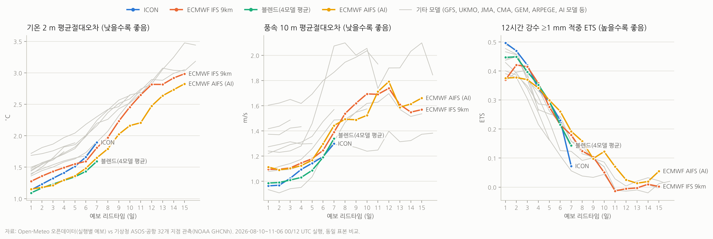

# 날씨 모델 검증 (한국, 2026-08 ~ 11)

12개 수치예보 모델과 4모델 블렌드의 과거 예보를 기상청 ASOS·공항 관측과 대조했다. 리드타임(1~15일)별로 기온·풍속·강수 성적을 매긴 결과다.
결과 해석과 앱 설계 반영 내용은 [`docs/PLAN.md` 3장](../../docs/PLAN.md#3-날씨-모델-검증-한국-날씨에-맞는-모델-찾기)에 있다.



## 데이터

| 구분 | 출처 | 비고 |
|---|---|---|
| 예보 | Open-Meteo 오픈데이터 `s3://openmeteo/data_run/` (AWS Open Data, 키 불필요) | 실행별 원본 `.om` 파일. 2026-08-10~11-06의 00/12 UTC 실행 |
| 관측 | NOAA GHCNh 2026 `s3://noaa-ghcnh-pds/hourly/access/by-year/2026/psv/` | 기상청 ASOS 29곳 + 공항 3곳. 목록은 [`results/stations.csv`](results/stations.csv) |
| 모델 지형고도 | `s3://openmeteo/data/{model}/static/HSURF.om` | 기온 고도 보정, 육지 격자 선택 |

## 실행 순서

```bash
pip install -r requirements.txt
```

```bash
./fetch_obs.sh 2026
```

```bash
WORKERS=64 python3 extract.py all 0000Z,1200Z
```

```bash
python3 build_pairs.py
```

```bash
python3 score.py
```

```bash
python3 bootstrap.py
```

```bash
python3 paired.py
```

```bash
python3 reliability.py
```

```bash
python3 charts.py ecmwf_aifs025_single
```

| 단계 | 산출물 |
|---|---|
| `extract.py` | `data/raw/{model}_{yyyy_mm_dd}_{HHMM}Z.npz` — 지점별 예보 시계열. 모델 12개 × 실행 178회, 64스레드로 약 18분 |
| `build_pairs.py` | `data/pairs_t.parquet`, `data/pairs_p.parquet` — 예보·관측 쌍 |
| `score.py` | `results/*_by_day.csv`, `*_by_region_d1-3.csv`, `precip_by_day.csv`, `summary_by_window.csv` |
| `bootstrap.py` | `results/bootstrap_ci.csv` — 구간별 90% 신뢰구간 |
| `paired.py` | `results/paired_differences.csv` — 모델 쌍 대응 비교 |
| `reliability.py` | `results/reliability_score.csv` — 앱용 신뢰도 점수(0~100)와 별점 |
| `charts.py` | `results/skill_by_lead.png` |

`data/`는 `.gitignore` 대상이다. 저장소에는 결과(`results/`)만 커밋한다.

## 방법 요점

- **격자 선택**
  - 관측소를 둘러싼 2×2 격자 중 바다(`HSURF = -999`)를 제외하고 고도가 가장 비슷한 격자를 쓴다.
  - 선택 결과는 [`results/grid_cells/`](results/grid_cells/)에 있다.
  - ECMWF IFS 9km는 O1280 감축 가우스 격자이며 [`grid.py`](grid.py)에서 처리한다.
- **기온**: 모델 지형고도와 관측소 고도 차이에 0.65 °C/100 m를 적용한다.
- **비교 시각**: 기온·바람은 00·06·12·18 UTC 값이다. 1·3·6시간 간격 모델을 같은 조건으로 비교하기 위해서다.
- **강수(예보)**
  - 시간축은 초기시각이 아니라 첫 스텝에서 시작한다.
  - 각 값은 직전 스텝 이후의 누적량이다.
  - 12·24시간 창을 정확히 덮는 스텝만 합산한다.
- **강수(관측)**
  - GHCNh의 일반 `precipitation` 열은 한국 BUFR 보고에서 누적 기간이 섞여 있어 사용하지 않았다.
  - 대신 BUFR 3시간 강수(`precipitation_3_hour`, FM94)를 쓴다. 24시간 누적과 97~100% 일치한다.
  - 3시간 강수는 주요 정시(00·03·…UTC)에 자주 누락된다. 그래서 02·05·…·23 UTC 값을 합산했다. 관측 창은 11/23 UTC에 끝나 모델 창보다 1시간 이르다.
- **동일 표본**
  - 리드타임마다 그날을 끝까지 덮는 모델만 포함한다(예: ICON 180 h → D1~7).
  - 그 모델들이 모두 예보를 가진 (지점, 초기시각, 유효시각)만 비교한다.
- **블렌드**: ECMWF IFS 9km, ICON, UKMO, GFS의 단순 평균이다. 결과를 보기 전에 지정했다.

## 알려진 한계

- **기간**: 3개월(늦여름~가을)이다. 계절별 성적은 출시 후 자동 검증으로 쌓는다.
- **기상청 모델**: KMA-UM 종료, Open-Meteo KMA 피드 2026-04 이후 중단, KIM은 공개 아카이브가 없어 포함하지 못했다.
- **관측 대표성**: 관측소는 골프장이 아니다. 특히 바람은 관측소 노출 조건의 영향이 크다.
